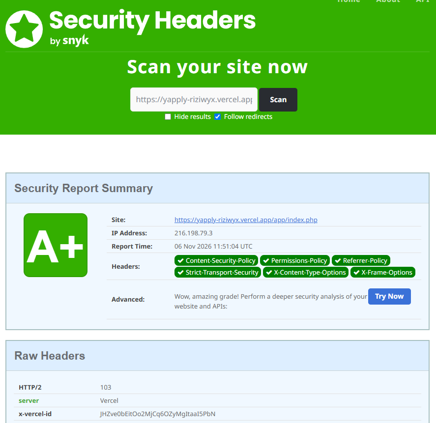

# Sécurité — Yapply

Ce document recense les failles de Yapply et leur correction, avec la catégorie
[OWASP Top 10 (2021)](https://owasp.org/Top10/), la référence CWE, la gravité et le
commit qui apporte le correctif.

| Branche | Statut |
|---|---|
| `securite` | Version corrigée, déployée sur https://yapply-riziwyx.vercel.app/ |
| `main` | Version d'origine, **volontairement vulnérable** : ne pas déployer |

---

## Signaler une vulnérabilité

Merci de **ne pas ouvrir d'issue publique**. Utilisez le signalement privé de GitHub
(onglet **Security** du dépôt, puis **Report a vulnerability**) en décrivant la faille,
la page concernée et les étapes pour la reproduire.

Périmètre : la branche `securite` et le site en ligne. La branche `main` est hors
périmètre, ses failles sont connues et documentées.

---

## Démarche

1. **Audit initial** de la version d'origine : revue manuelle du code (white-box),
   12 failles relevées → [`doc/AUDIT_SECURITE_YAPPLY.md`](doc/AUDIT_SECURITE_YAPPLY.md).
2. **Corrections** sur la branche `securite` : migration des fichiers texte vers
   PostgreSQL, puis correction faille par faille.
3. **Re-audit** (novembre 2026) : vérification de chaque correctif dans le code et
   recherche de ce que l'audit initial avait manqué → 6 nouveaux points (N-1 à N-6).
4. **Tests** : chaque correctif du re-audit a été vérifié par des requêtes HTTP sur
   une instance locale, sur l'ancien code (la faille est reproduite) puis sur le
   nouveau (elle ne l'est plus).

Gravité : 🔴 Critique · 🟠 Importante · 🟡 Modérée · ⚪ Information

---

## Failles de l'audit initial

| ID | Faille | OWASP 2021 | CWE | Gravité | Correctif | Commit(s) |
|---|---|---|---|---|---|---|
| F-01 | Upload de fichiers non restreint (exécution de code) | A04 Conception non sécurisée | [CWE-434][cwe434] | 🔴 | Type réel lu dans le contenu (`finfo`), image ré-encodée avec GD (tout code caché disparaît), taille et nombre de pixels limités, nom aléatoire, stockage en base, renvoi en `image/jpeg` avec `nosniff` | [`f49ecfc`][f49ecfc] |
| F-02 | Mots de passe stockés en clair | A02 Défaillances cryptographiques | [CWE-256][cwe256] | 🔴 | `password_hash()` (bcrypt) et `password_verify()`, hash mis à jour si l'algorithme évolue, faux hash pour un temps de réponse identique que le compte existe ou non | [`6c1134e`][6c1134e] |
| F-03 | Session unique partagée dans un fichier | A07 Identification et authentification | [CWE-488][cwe488] | 🔴 | Sessions PHP natives stockées en base, identifiant renouvelé à la connexion, cookie `HttpOnly`, `SameSite=Lax` et `Secure` | [`6c1134e`][6c1134e] |
| F-04 | Injection de séparateur dans les fichiers de données | A03 Injection | [CWE-74][cwe74] | 🔴 | Données en base PostgreSQL avec requêtes préparées, pseudo limité à `[A-Za-z0-9_.-]` dans le code et par une contrainte `CHECK` | [`5de06b0`][5de06b0] [`6c1134e`][6c1134e] |
| F-05 | Dossier `data/` accessible depuis le web | A01 Contrôle d'accès défaillant | [CWE-552][cwe552] | 🔴 | Plus aucun fichier de données ; `data/`, `database/` et `.env` exclus du déploiement ; `/src`, `/database`, `/data` et `/api` renvoient 404 | [`3135094`][3135094] [`9f2312f`][9f2312f] [`ad8ab5a`][ad8ab5a] |
| F-06 | XSS stocké | A03 Injection | [CWE-79][cwe79] | 🟠 | Échappement de toutes les données affichées avec `e()` (`htmlspecialchars`, `ENT_QUOTES`), puis CSP stricte sans `'unsafe-inline'` | [`6c1134e`][6c1134e] [`2007912`][2007912] [`ad8ab5a`][ad8ab5a] [`2d49b6d`][2d49b6d] |
| F-07 | Absence de protection CSRF | A01 Contrôle d'accès défaillant | [CWE-352][cwe352] | 🟠 | Jeton de 256 bits par session, vérifié automatiquement sur toute requête POST (`hash_equals`), renouvelé à la connexion | [`dd059a3`][dd059a3] |
| F-08 | Path traversal dans la messagerie | A01 Contrôle d'accès défaillant | [CWE-22][cwe22] | 🟠 | Plus aucun chemin de fichier construit à partir d'une saisie : messages et notifications en base, interlocuteur retrouvé par son pseudo puis désigné par son id | [`ad8ab5a`][ad8ab5a] |
| F-09 | Vérification d'unicité incomplète | A04 Conception non sécurisée | — | 🟠 | Contraintes `UNIQUE` sur le pseudo et le mail (insensibles à la casse), violation traitée proprement | [`5de06b0`][5de06b0] [`6c1134e`][6c1134e] |
| F-10 | Accès concurrents (race conditions) | A04 Conception non sécurisée | [CWE-362][cwe362] | 🟡 | Écritures atomiques en base : clé primaire (un like par membre), `ON CONFLICT`, transaction pour un post avec image | [`2007912`][2007912] [`f49ecfc`][f49ecfc] |
| F-11 | Politique de mot de passe faible | A07 Identification et authentification | [CWE-521][cwe521] | 🟡 | ⚠️ **Partiel** : 8 caractères minimum, sans règles de composition. Il manque une longueur maximale et le refus des mots de passe courants (voir « Limites connues ») | [`6c1134e`][6c1134e] |
| F-12 | Écriture de notifications sans filtrage | A04 Conception non sécurisée | [CWE-73][cwe73] | 🟡 | Notifications en base (type `ENUM`, identifiants), texte construit côté serveur à partir de phrases fixes | [`2007912`][2007912] |

---

## Failles trouvées au re-audit

| ID | Faille | OWASP 2021 | CWE | Gravité | Correctif | Commit(s) |
|---|---|---|---|---|---|---|
| N-1 | Sessions jamais expirées côté serveur, et mode strict sans effet : un cookie volé restait valable indéfiniment, un identifiant inventé était accepté | A07 Identification et authentification | [CWE-613][cwe613] | 🟠 | Session inactive depuis plus de 30 min ignorée à chaque lecture ; `validateId()` refuse les identifiants inconnus ou expirés ; ménage des sessions réactivé | [`9caabc4`][9caabc4] |
| N-2 | Mail et mot de passe modifiables sans le mot de passe actuel | A07 Identification et authentification | [CWE-620][cwe620] | 🟠 | Mot de passe actuel exigé, avec la même limite d'essais que la connexion | [`0479909`][0479909] |
| N-3 | Déconnexion par simple lien (CSRF de déconnexion) | A01 Contrôle d'accès défaillant | [CWE-352][cwe352] | 🟡 | Formulaire POST avec jeton CSRF ; une requête GET ne déconnecte plus | [`1347a59`][1347a59] |
| N-4 | Limite d'essais contournable : pseudo et mail comptés séparément, compteur remis à zéro par un changement de pseudo | A07 Identification et authentification | [CWE-307][cwe307] | 🟡 | Échecs comptés par compte (clé fondée sur l'id, qui ne change jamais) | [`68e2c8b`][68e2c8b] |
| N-5 | Paramètre envoyé sous forme de tableau (`champ[]=…`) : erreur 500 | A03 Injection | [CWE-20][cwe20] | 🟡 | Refus centralisé (erreur 400) de tout paramètre qui n'est pas une chaîne | [`68e2c8b`][68e2c8b] |
| N-6 | En local, `php -S` sert aussi `.env` et `database/*.sql` | A05 Mauvaise configuration | [CWE-552][cwe552] | ⚪ | Non corrigé : ne concerne que le serveur de développement, qui n'écoute que sur `localhost` | — |

---

## Durcissement supplémentaire

Mesures qui ne répondent pas à une faille de l'audit, mais réduisent la surface d'attaque :

| Mesure | Commit(s) |
|---|---|
| Requêtes préparées partout (PDO, émulation désactivée) : pas d'injection SQL possible | [`3135094`][3135094] [`6c1134e`][6c1134e] |
| Limite de 5 échecs de connexion par 15 min, par compte et par IP (la version d'origine n'avait aucune limite, et l'audit ne l'avait pas relevé) | [`6c1134e`][6c1134e] [`68e2c8b`][68e2c8b] |
| Un seul like par membre et par post (avant : compteur incrémentable à l'infini) | [`5de06b0`][5de06b0] [`2007912`][2007912] |
| Ajout d'ami limité aux membres existants (avant : n'importe quel texte était accepté) | [`ad8ab5a`][ad8ab5a] |
| Erreurs masquées en production, détails envoyés dans les journaux | [`4ea135e`][4ea135e] |
| Point d'entrée unique sur Vercel, avec liste blanche des pages | [`9f2312f`][9f2312f] |
| Rôle PostgreSQL applicatif sans droits sur la structure (`database/roles.sql`) | [`5de06b0`][5de06b0] |
| En-têtes `X-Content-Type-Options`, `Referrer-Policy`, `X-Frame-Options` | [`3135094`][3135094] |
| CSP stricte (script et style inline retirés, test en `Report-Only` avant activation) et `Permissions-Policy` | [`42741db`][42741db] [`834e93c`][834e93c] [`4985007`][4985007] [`2d49b6d`][2d49b6d] |
| `Strict-Transport-Security` | Envoyé par Vercel |

Résultat sur [securityheaders.com](https://securityheaders.com/?q=https%3A%2F%2Fyapply-riziwyx.vercel.app%2Fapp%2Findex.php&followRedirects=on) :

---

## Limites connues

- **F-11 (partiel)** : pas de longueur maximale. bcrypt ignore tout ce qui dépasse
  72 octets, et aucun mot de passe courant n'est refusé. Pour un mot de passe utilisé
  seul, la NIST (SP 800-63B, révision 4) recommande au moins 15 caractères.
- **Blocage de compte** : 5 échecs bloquent le compte pendant 15 minutes, ce qui permet
  à un tiers de gêner un membre. C'est le compromis choisi contre le brute force.
- **Sessions** : changer de mot de passe ne ferme pas les autres sessions ouvertes.
- **Fonctions absentes** : pas de double authentification, pas de vérification de
  l'adresse mail, pas de réinitialisation du mot de passe.
- **Tests automatisés** : les vérifications du re-audit ont été faites à la main en
  local ; elles ne sont pas encore intégrées à une CI.

[f49ecfc]: https://github.com/RIZIWYX/Yapply/commit/f49ecfc
[6c1134e]: https://github.com/RIZIWYX/Yapply/commit/6c1134e
[5de06b0]: https://github.com/RIZIWYX/Yapply/commit/5de06b0
[3135094]: https://github.com/RIZIWYX/Yapply/commit/3135094
[9f2312f]: https://github.com/RIZIWYX/Yapply/commit/9f2312f
[ad8ab5a]: https://github.com/RIZIWYX/Yapply/commit/ad8ab5a
[2007912]: https://github.com/RIZIWYX/Yapply/commit/2007912
[2d49b6d]: https://github.com/RIZIWYX/Yapply/commit/2d49b6d
[dd059a3]: https://github.com/RIZIWYX/Yapply/commit/dd059a3
[4ea135e]: https://github.com/RIZIWYX/Yapply/commit/4ea135e
[42741db]: https://github.com/RIZIWYX/Yapply/commit/42741db
[834e93c]: https://github.com/RIZIWYX/Yapply/commit/834e93c
[4985007]: https://github.com/RIZIWYX/Yapply/commit/4985007
[9caabc4]: https://github.com/RIZIWYX/Yapply/commit/9caabc4
[0479909]: https://github.com/RIZIWYX/Yapply/commit/0479909
[1347a59]: https://github.com/RIZIWYX/Yapply/commit/1347a59
[68e2c8b]: https://github.com/RIZIWYX/Yapply/commit/68e2c8b
[cwe20]: https://cwe.mitre.org/data/definitions/20.html
[cwe22]: https://cwe.mitre.org/data/definitions/22.html
[cwe73]: https://cwe.mitre.org/data/definitions/73.html
[cwe74]: https://cwe.mitre.org/data/definitions/74.html
[cwe79]: https://cwe.mitre.org/data/definitions/79.html
[cwe256]: https://cwe.mitre.org/data/definitions/256.html
[cwe307]: https://cwe.mitre.org/data/definitions/307.html
[cwe352]: https://cwe.mitre.org/data/definitions/352.html
[cwe362]: https://cwe.mitre.org/data/definitions/362.html
[cwe434]: https://cwe.mitre.org/data/definitions/434.html
[cwe488]: https://cwe.mitre.org/data/definitions/488.html
[cwe521]: https://cwe.mitre.org/data/definitions/521.html
[cwe552]: https://cwe.mitre.org/data/definitions/552.html
[cwe613]: https://cwe.mitre.org/data/definitions/613.html
[cwe620]: https://cwe.mitre.org/data/definitions/620.html
