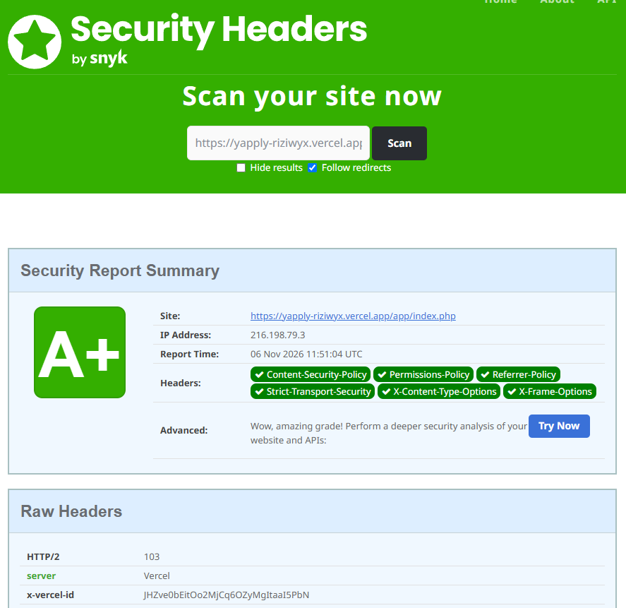

# Réponse à l'audit de sécurité de Yapply

> **En réponse à :** [Audit de sécurité de Yapply](AUDIT_SECURITE_YAPPLY.md) (Rayane Graïne, juin 2026)
>
> **Date :** novembre 2026
>
> **Périmètre :** branche `securite`, en ligne sur https://yapply-riziwyx.vercel.app/
>
> **Méthode :** correction faille par faille, puis re-vérification complète du code et tests HTTP sur une instance locale

---

## Résumé

L'audit relevait **12 failles** : 5 critiques, 4 importantes et 3 modérées. Elles ont toutes
été traitées : 11 sont corrigées et F-11 l'est en partie.

Une fois les correctifs en place, le code a été relu entièrement pour vérifier chaque
correction et chercher ce qui aurait pu être oublié. Cette re-vérification a fait
apparaître **6 nouveaux points** (N-1 à N-6). Cinq sont corrigés, le sixième ne concerne
que le serveur de développement.

L'audit concluait que l'application ne devait pas être déployée en l'état. La branche
`securite` est maintenant en ligne. La branche `main` garde la version d'origine et ses
failles, comme point de comparaison : elle ne doit pas être déployée.

Pour chaque faille, ce document reprend le numéro et la gravité donnés par l'audit,
rappelle le problème, décrit le correctif et indique le commit qui l'apporte. La
classification suit l'[OWASP Top 10 (2021)](https://owasp.org/Top10/) et le
[CWE](https://cwe.mitre.org/).

### Ordre des corrections

Le plan de remédiation de l'audit a servi de base, avec un changement de méthode : au
lieu de corriger les fichiers texte un par un, toutes les données sont passées dans une
base PostgreSQL. Cette migration règle d'un coup plusieurs failles liées au stockage
(F-03, F-04, F-05, F-08, F-09, F-10, F-12) et elle était nécessaire au déploiement sur
Vercel, qui n'a pas de disque persistant.

1. Schéma de la base, rôle applicatif et déploiement Vercel.
2. Comptes, mots de passe et sessions en base (priorité 1 de l'audit).
3. Posts, likes, commentaires, notifications, amis et messagerie en base.
4. Protection CSRF, puis contrôle des images envoyées.
5. En-têtes de sécurité et CSP.
6. Re-vérification du code et correction des points N-1 à N-5.

---

## Failles critiques

### F-01 : Upload de fichiers non restreint (RCE possible)

**Sévérité :** Critique
**Statut :** Corrigée
**Classification :** OWASP A04 (Conception non sécurisée), [CWE-434][cwe434]
**Commit :** [`f49ecfc`][f49ecfc]

**Rappel :** le fichier envoyé était enregistré sous son propre nom, sans aucun contrôle,
dans un dossier public. Un fichier `shell.php` pouvait donc être exécuté.

**Correctif appliqué** ([`src/images.php`](../src/images.php), [`app/image.php`](../app/image.php)) :
- taille limitée à 2 Mo et nombre de pixels limité (protection contre les images piégées) ;
- type réel lu dans le contenu du fichier avec `finfo` : seuls JPEG, PNG et WebP passent ;
- image décodée puis entièrement ré-encodée en JPEG avec GD, ce qui supprime tout code
  caché et les métadonnées (EXIF, GPS) ;
- nom aléatoire généré par le serveur, le nom d'origine est ignoré ;
- stockage en base, puis renvoi par `image.php` avec `Content-Type: image/jpeg`,
  `X-Content-Type-Options: nosniff` et une CSP `sandbox`, aux seuls membres connectés.

**Par rapport à la recommandation :** les contrôles demandés (type réel, taille, nom
aléatoire) sont en place. Le ré-encodage va plus loin qu'une liste d'extensions. Le
blocage par `.htaccess` n'a plus d'objet : aucun fichier envoyé n'est écrit sur le disque.

### F-02 : Mots de passe stockés en clair

**Sévérité :** Critique
**Statut :** Corrigée
**Classification :** OWASP A02 (Défaillances cryptographiques), [CWE-256][cwe256]
**Commit :** [`6c1134e`][6c1134e]

**Rappel :** les mots de passe étaient écrits en clair dans `comptes.txt`, et deux fois
(mot de passe et confirmation).

**Correctif appliqué** ([`app/inscription_traitement.php`](../app/inscription_traitement.php), [`app/connexion_traitement.php`](../app/connexion_traitement.php)) :
- `password_hash()` à l'inscription (bcrypt, avec sel automatique), et la confirmation
  n'est plus stockée ;
- `password_verify()` à la connexion ;
- hash recalculé automatiquement si l'algorithme par défaut de PHP évolue ;
- si le compte n'existe pas, un faux hash est quand même vérifié, pour que le temps de
  réponse ne révèle pas si un pseudo existe.

**Par rapport à la recommandation :** conforme.

### F-03 : Système de session cassé (fichier partagé)

**Sévérité :** Critique
**Statut :** Corrigée
**Classification :** OWASP A07 (Identification et authentification), [CWE-488][cwe488]
**Commits :** [`6c1134e`][6c1134e], complété par [`9caabc4`][9caabc4] (voir N-1)

**Rappel :** un seul fichier `session.txt` gardait l'utilisateur connecté pour tout le
site : la dernière personne connectée écrasait les autres.

**Correctif appliqué** ([`src/session.php`](../src/session.php)) :
- sessions PHP natives, une par visiteur, stockées en base (Vercel n'a pas de disque
  partagé entre les requêtes) ;
- nouvel identifiant de session à la connexion et à l'inscription (contre la fixation de
  session) ;
- cookie `HttpOnly` (illisible en JavaScript), `SameSite=Lax`, `Secure` en HTTPS, et
  jamais d'identifiant dans l'URL.

**Par rapport à la recommandation :** conforme. La re-vérification a montré que ces
sessions n'expiraient pas côté serveur, ce qui a été corrigé ensuite (N-1).

### F-04 : Injection de séparateur (Data corruption)

**Sévérité :** Critique
**Statut :** Corrigée
**Classification :** OWASP A03 (Injection), [CWE-74][cwe74]
**Commits :** [`5de06b0`][5de06b0], [`6c1134e`][6c1134e]

**Rappel :** un `;` ou un retour à la ligne dans un champ permettait d'ajouter de fausses
lignes dans `comptes.txt`.

**Correctif appliqué :**
- les données sont dans PostgreSQL et toutes les requêtes sont préparées : une valeur ne
  peut plus être interprétée comme une structure ;
- le pseudo est limité à `[A-Za-z0-9_.-]` (2 à 30 caractères), dans le code et par une
  contrainte `CHECK` en base ;
- le mail est validé avec `FILTER_VALIDATE_EMAIL`, le prénom et le nom sont limités en
  longueur.

**Par rapport à la recommandation :** la liste blanche de caractères est appliquée au
pseudo. Pour les autres champs, la séparation des données et des requêtes rend le
filtrage des séparateurs inutile.

### F-05 : Données sensibles dans la racine web

**Sévérité :** Critique
**Statut :** Corrigée
**Classification :** OWASP A01 (Contrôle d'accès défaillant), [CWE-552][cwe552]
**Commits :** [`3135094`][3135094], [`9f2312f`][9f2312f], [`ad8ab5a`][ad8ab5a]

**Rappel :** le dossier `data/`, avec les comptes et les mots de passe, était
téléchargeable depuis le navigateur.

**Correctif appliqué :**
- plus aucune donnée n'est stockée dans des fichiers : tout est en base ;
- `data/`, `database/` et `.env` sont exclus du déploiement (`.vercelignore`) ;
- les adresses `/src`, `/database`, `/data` et `/api` renvoient une erreur 404
  ([`vercel.json`](../vercel.json)), et seules les pages de `app/` passent par le point
  d'entrée, avec une liste blanche ([`api/index.php`](../api/index.php)).

**Par rapport à la recommandation :** déplacer ou bloquer `data/` n'est plus nécessaire,
puisque le dossier n'est plus utilisé. Vercel n'utilise pas Apache, d'où le blocage par
les routes de `vercel.json` plutôt que par `.htaccess`.

---

## Failles importantes

### F-06 : XSS stocké (Cross-Site Scripting)

**Sévérité :** Importante
**Statut :** Corrigée
**Classification :** OWASP A03 (Injection), [CWE-79][cwe79]
**Commits :** [`6c1134e`][6c1134e], [`2007912`][2007912], [`ad8ab5a`][ad8ab5a], CSP : [`2d49b6d`][2d49b6d]

**Rappel :** bio, posts, messages et prénoms étaient affichés sans échappement.

**Correctif appliqué :**
- fonction `e()` ([`src/config.php`](../src/config.php)), qui appelle `htmlspecialchars`
  avec `ENT_QUOTES` en UTF-8, utilisée pour toutes les données venant d'un utilisateur ;
- Content Security Policy stricte (`script-src 'self'`, sans `'unsafe-inline'`) : même si
  un échappement était oublié, un script injecté ne s'exécuterait pas. Le seul script
  inline du site a été déplacé dans `assets/js/message.js` ([`42741db`][42741db]).

**Par rapport à la recommandation :** conforme, avec la CSP comme seconde protection.

### F-07 : Absence totale de protection CSRF

**Sévérité :** Importante
**Statut :** Corrigée
**Classification :** OWASP A01 (Contrôle d'accès défaillant), [CWE-352][cwe352]
**Commits :** [`dd059a3`][dd059a3], complété par [`1347a59`][1347a59] (voir N-3)

**Rappel :** un site malveillant pouvait faire poster, liker ou ajouter des amis au nom
d'un membre connecté.

**Correctif appliqué** ([`src/config.php`](../src/config.php)) :
- jeton aléatoire de 256 bits par session, placé dans chaque formulaire ;
- vérification automatique de toutes les requêtes POST du site, comparaison avec
  `hash_equals` ;
- nouveau jeton après la connexion et l'inscription ;
- cookie de session `SameSite=Lax` en protection supplémentaire.

**Par rapport à la recommandation :** conforme. La vérification est centralisée : aucune
page ne peut l'oublier.

### F-08 : Path Traversal dans la messagerie

**Sévérité :** Importante
**Statut :** Corrigée
**Classification :** OWASP A01 (Contrôle d'accès défaillant), [CWE-22][cwe22]
**Commit :** [`ad8ab5a`][ad8ab5a]

**Rappel :** le nom du fichier de conversation était construit avec `$autre`, reçu du
formulaire sans validation.

**Complément :** la re-vérification a identifié un second point d'entrée dans le même
fichier. Le chemin de la notification de message était lui aussi construit avec `$autre`
(`DOSSIER_NOTIFS . '/' . $autre . '.txt'`) : avec `avec=../comptes`, chaque message
envoyé ajoutait une ligne dans `data/comptes.txt`.

**Correctif appliqué** ([`app/message.php`](../app/message.php)) : aucun chemin de
fichier n'est plus construit à partir d'une saisie. Messages et notifications sont en
base. L'interlocuteur est recherché par son pseudo avec une requête préparée, puis
désigné par son identifiant.

**Par rapport à la recommandation :** la liste blanche recommandée n'est plus
nécessaire, puisqu'il n'y a plus de fichier. Les deux points d'entrée sont supprimés.

### F-09 : Vérification d'unicité incomplète

**Sévérité :** Importante
**Statut :** Corrigée
**Classification :** OWASP A04 (Conception non sécurisée)
**Commits :** [`5de06b0`][5de06b0], [`6c1134e`][6c1134e]

**Rappel :** la boucle de vérification s'arrêtait trop tôt, ce qui permettait des mails
en double.

**Correctif appliqué :** c'est la base qui garantit l'unicité, avec des contraintes
`UNIQUE` sur le pseudo et le mail, insensibles à la casse (type `citext`). Une
violation (code `23505`) est traitée et affiche un message clair, à l'inscription comme
à la modification du compte.

**Par rapport à la recommandation :** la contrainte en base remplace le parcours
complet de la liste. Elle tient aussi quand deux inscriptions arrivent au même moment.

---

## Failles modérées

### F-10 : Pas de protection contre la concurrence (race conditions)

**Sévérité :** Modérée
**Statut :** Corrigée
**Classification :** OWASP A04 (Conception non sécurisée), [CWE-362][cwe362]
**Commits :** [`2007912`][2007912], [`f49ecfc`][f49ecfc]

**Rappel :** les fichiers étaient lus puis réécrits sans verrou, ce qui pouvait perdre
des likes ou des commentaires.

**Correctif appliqué :** chaque action est une écriture atomique en base. Un like est une
ligne avec une clé primaire (post, membre), et `ON CONFLICT DO NOTHING` gère deux clics
simultanés. Un post avec image est enregistré dans une transaction.

**Par rapport à la recommandation :** `flock()` n'est plus nécessaire, PostgreSQL gère
la concurrence.

### F-11 : Validation insuffisante du mot de passe

**Sévérité :** Modérée
**Statut :** Partiellement corrigée
**Classification :** OWASP A07 (Identification et authentification), [CWE-521][cwe521]
**Commit :** [`6c1134e`][6c1134e]

**Rappel :** seule une longueur de 6 caractères était exigée.

**Correctif appliqué :** 8 caractères minimum à l'inscription et à la modification.

**Par rapport à la recommandation :** les règles de complexité (majuscule, chiffre)
n'ont pas été retenues, volontairement. Les recommandations actuelles, en particulier
la NIST SP 800-63B, déconseillent ces règles et privilégient la longueur et le refus des
mots de passe courants.

**Reste à faire :** une longueur maximale (bcrypt ignore ce qui dépasse 72 octets), une
liste de mots de passe courants refusés, et un minimum de 15 caractères pour suivre la
révision 4 de la NIST quand le mot de passe est le seul facteur.

### F-12 : Notifications sans validation

**Sévérité :** Modérée
**Statut :** Corrigée
**Classification :** OWASP A04 (Conception non sécurisée), [CWE-73][cwe73]
**Commit :** [`2007912`][2007912]

**Rappel :** le code écrivait dans tous les fichiers du dossier des notifications, sans
vérifier leur nom.

**Correctif appliqué :** les notifications sont des lignes en base, avec un type limité
par un `ENUM` et des identifiants de membres. Le texte affiché est construit côté
serveur à partir de phrases fixes.

**Par rapport à la recommandation :** le filtrage des noms de fichiers n'est plus
nécessaire, il n'y a plus de fichier.

---

## Failles trouvées lors de la re-vérification

Ces points ne figuraient pas dans l'audit. N-1 à N-5 concernent la nouvelle version.

### N-1 : Sessions jamais expirées côté serveur

**Sévérité :** Importante
**Statut :** Corrigée
**Classification :** OWASP A07 (Identification et authentification), [CWE-613][cwe613]
**Commit :** [`9caabc4`][9caabc4]

**Problème :** la lecture d'une session ne vérifiait pas son âge. La suppression des
vieilles sessions dépendait du ramasse-miettes de PHP, désactivé par défaut sur Ubuntu.
Un cookie volé restait donc valable indéfiniment. De plus, sans `validateId()`, le mode
strict de PHP n'avait aucun effet : un identifiant de session inventé était accepté.

**Correctif appliqué** ([`src/session.php`](../src/session.php)) : une session inactive
depuis plus de 30 minutes est ignorée à chaque lecture. `validateId()` refuse les
identifiants inconnus ou expirés, et PHP en crée alors un nouveau. Le ramasse-miettes
est réactivé pour vider la table.

### N-2 : Mail et mot de passe modifiables sans le mot de passe actuel

**Sévérité :** Importante
**Statut :** Corrigée
**Classification :** OWASP A07 (Identification et authentification), [CWE-620][cwe620]
**Commit :** [`0479909`][0479909]

**Problème :** une personne ayant accès à une session ouverte (cookie volé, ordinateur
resté allumé) pouvait changer le mail et le mot de passe, et s'approprier le compte.

**Correctif appliqué** ([`app/modifier_traitement.php`](../app/modifier_traitement.php)) :
le mot de passe actuel est demandé pour changer le mail ou le mot de passe, avec la même
limite d'essais que la connexion. Sans cette limite, le formulaire aurait permis de
deviner le mot de passe.

### N-3 : Déconnexion par simple lien

**Sévérité :** Modérée
**Statut :** Corrigée
**Classification :** OWASP A01 (Contrôle d'accès défaillant), [CWE-352][cwe352]
**Commit :** [`1347a59`][1347a59]

**Problème :** la déconnexion était un lien (requête GET), qui échappait donc à la
protection CSRF. N'importe quel site pouvait déconnecter un membre avec une simple image
pointant vers `deconnexion.php`.

**Correctif appliqué :** le bouton de déconnexion est un formulaire POST avec jeton, et
une requête GET sur `deconnexion.php` ne déconnecte plus.

### N-4 : Limite d'essais contournable

**Sévérité :** Modérée
**Statut :** Corrigée
**Classification :** OWASP A07 (Identification et authentification), [CWE-307][cwe307]
**Commit :** [`68e2c8b`][68e2c8b]

**Problème :** les échecs étaient comptés selon le texte saisi. Le pseudo et le mail d'un
même compte avaient chacun leur compteur, et sur la page de modification, un changement
de pseudo remettait le compteur à zéro.

**Correctif appliqué :** les échecs sont comptés par compte, avec une clé fondée sur son
identifiant, qui ne change jamais. Pour un compte inexistant, le texte saisi est compté,
ce qui ne révèle pas si le compte existe.

### N-5 : Paramètres envoyés sous forme de tableau

**Sévérité :** Modérée
**Statut :** Corrigée
**Classification :** OWASP A03 (Injection), [CWE-20][cwe20]
**Commit :** [`68e2c8b`][68e2c8b]

**Problème :** un paramètre comme `?avec[]=x` faisait planter la page (erreur 500).

**Correctif appliqué :** toute requête dont un paramètre n'est pas une simple chaîne est
refusée avec une erreur 400, au chargement de [`src/config.php`](../src/config.php),
avant tout traitement.

### N-6 : Fichiers sensibles servis en local

**Sévérité :** Information
**Statut :** Accepté
**Classification :** OWASP A05 (Mauvaise configuration), [CWE-552][cwe552]

**Problème :** lancé depuis la racine du projet, le serveur intégré de PHP (`php -S`)
sert aussi `.env` et les fichiers de `database/`.

**Décision :** non corrigé. Cela ne concerne que le poste de développement, et le serveur
n'écoute que sur `localhost`. En production, ces fichiers ne sont pas déployés.

---

## Autres mesures de sécurité

Ces mesures ne répondent pas directement à une faille de l'audit. Les trois premières
corrigent des défauts de la version d'origine que l'audit n'avait pas relevés.

| Mesure | Commit(s) |
|---|---|
| Limite de 5 échecs de connexion en 15 minutes, par compte et par IP (la version d'origine n'en avait aucune) | [`6c1134e`][6c1134e], [`68e2c8b`][68e2c8b] |
| Un seul like par membre et par post (le compteur pouvait être augmenté à l'infini) | [`5de06b0`][5de06b0], [`2007912`][2007912] |
| Ajout d'ami limité aux membres existants (n'importe quel texte était accepté) | [`ad8ab5a`][ad8ab5a] |
| Requêtes préparées partout (PDO, émulation désactivée), donc pas d'injection SQL | [`3135094`][3135094], [`6c1134e`][6c1134e] |
| Erreurs masquées en production, détails envoyés dans les journaux | [`4ea135e`][4ea135e] |
| Point d'entrée unique sur Vercel, avec liste blanche des pages | [`9f2312f`][9f2312f] |
| Rôle PostgreSQL applicatif sans droits sur la structure ([`database/roles.sql`](../database/roles.sql)) | [`5de06b0`][5de06b0] |
| En-têtes `X-Content-Type-Options`, `Referrer-Policy` et `X-Frame-Options` | [`3135094`][3135094] |
| CSP stricte (testée en `Report-Only` avant activation) et `Permissions-Policy` | [`834e93c`][834e93c], [`4985007`][4985007], [`2d49b6d`][2d49b6d] |
| `Strict-Transport-Security` | envoyé par Vercel |

Résultat sur [securityheaders.com](https://securityheaders.com/?q=https%3A%2F%2Fyapply-riziwyx.vercel.app%2Fapp%2Findex.php&followRedirects=on) :

---

## Tableau récapitulatif

| ID | Faille | Sévérité | OWASP 2021 | Statut | Commit(s) |
|----|--------|----------|------------|--------|-----------|
| F-01 | Upload non restreint (RCE) | Critique | A04 | Corrigée | [`f49ecfc`][f49ecfc] |
| F-02 | Mots de passe en clair | Critique | A02 | Corrigée | [`6c1134e`][6c1134e] |
| F-03 | Sessions cassées | Critique | A07 | Corrigée | [`6c1134e`][6c1134e], [`9caabc4`][9caabc4] |
| F-04 | Injection de séparateur | Critique | A03 | Corrigée | [`5de06b0`][5de06b0], [`6c1134e`][6c1134e] |
| F-05 | `data/` exposé sur le web | Critique | A01 | Corrigée | [`3135094`][3135094], [`9f2312f`][9f2312f], [`ad8ab5a`][ad8ab5a] |
| F-06 | XSS stocké | Importante | A03 | Corrigée | [`6c1134e`][6c1134e], [`2007912`][2007912], [`ad8ab5a`][ad8ab5a], [`2d49b6d`][2d49b6d] |
| F-07 | Pas de CSRF | Importante | A01 | Corrigée | [`dd059a3`][dd059a3], [`1347a59`][1347a59] |
| F-08 | Path Traversal | Importante | A01 | Corrigée | [`ad8ab5a`][ad8ab5a] |
| F-09 | Unicité incomplète | Importante | A04 | Corrigée | [`5de06b0`][5de06b0], [`6c1134e`][6c1134e] |
| F-10 | Race conditions | Modérée | A04 | Corrigée | [`2007912`][2007912], [`f49ecfc`][f49ecfc] |
| F-11 | Mot de passe faible | Modérée | A07 | Partielle | [`6c1134e`][6c1134e] |
| F-12 | Notifs sans filtre | Modérée | A04 | Corrigée | [`2007912`][2007912] |
| N-1 | Sessions sans expiration | Importante | A07 | Corrigée | [`9caabc4`][9caabc4] |
| N-2 | Changement de mail ou de mot de passe sans l'actuel | Importante | A07 | Corrigée | [`0479909`][0479909] |
| N-3 | Déconnexion par lien | Modérée | A01 | Corrigée | [`1347a59`][1347a59] |
| N-4 | Limite d'essais contournable | Modérée | A07 | Corrigée | [`68e2c8b`][68e2c8b] |
| N-5 | Paramètres en tableau | Modérée | A03 | Corrigée | [`68e2c8b`][68e2c8b] |
| N-6 | Fichiers servis en local | Information | A05 | Accepté | |

---

## Limites connues

- **F-11** : voir « Reste à faire » plus haut.
- **Blocage de compte** : 5 échecs bloquent le compte pendant 15 minutes, ce qui permet à
  un tiers de gêner un membre. C'est le compromis choisi contre les attaques par force
  brute.
- **Sessions** : changer de mot de passe ne ferme pas les autres sessions ouvertes.
- **Fonctions absentes** : pas de double authentification, pas de vérification de
  l'adresse mail, pas de réinitialisation du mot de passe.
- **Tests** : les vérifications de la re-vérification ont été faites en local, à la
  main. Elles ne sont pas encore lancées automatiquement à chaque push.

---

## Signaler une vulnérabilité

Merci de ne pas ouvrir d'issue publique. Utilisez le signalement privé de GitHub (onglet
**Security** du dépôt, puis **Report a vulnerability**) en indiquant la page concernée
et les étapes pour reproduire le problème. Le périmètre est la branche `securite` et le
site en ligne. Les failles de la branche `main` sont connues et documentées.

---

## Références

- Audit initial : [AUDIT_SECURITE_YAPPLY.md](AUDIT_SECURITE_YAPPLY.md)
- OWASP Top 10 (2021) : https://owasp.org/Top10/
- OWASP Cheat Sheet Series : https://cheatsheetseries.owasp.org/
- NIST SP 800-63B, recommandations sur l'authentification : https://pages.nist.gov/800-63-4/sp800-63b.html

[f49ecfc]: https://github.com/RIZIWYX/Yapply/commit/f49ecfc
[6c1134e]: https://github.com/RIZIWYX/Yapply/commit/6c1134e
[5de06b0]: https://github.com/RIZIWYX/Yapply/commit/5de06b0
[3135094]: https://github.com/RIZIWYX/Yapply/commit/3135094
[9f2312f]: https://github.com/RIZIWYX/Yapply/commit/9f2312f
[ad8ab5a]: https://github.com/RIZIWYX/Yapply/commit/ad8ab5a
[2007912]: https://github.com/RIZIWYX/Yapply/commit/2007912
[2d49b6d]: https://github.com/RIZIWYX/Yapply/commit/2d49b6d
[dd059a3]: https://github.com/RIZIWYX/Yapply/commit/dd059a3
[4ea135e]: https://github.com/RIZIWYX/Yapply/commit/4ea135e
[42741db]: https://github.com/RIZIWYX/Yapply/commit/42741db
[834e93c]: https://github.com/RIZIWYX/Yapply/commit/834e93c
[4985007]: https://github.com/RIZIWYX/Yapply/commit/4985007
[9caabc4]: https://github.com/RIZIWYX/Yapply/commit/9caabc4
[0479909]: https://github.com/RIZIWYX/Yapply/commit/0479909
[1347a59]: https://github.com/RIZIWYX/Yapply/commit/1347a59
[68e2c8b]: https://github.com/RIZIWYX/Yapply/commit/68e2c8b
[cwe20]: https://cwe.mitre.org/data/definitions/20.html
[cwe22]: https://cwe.mitre.org/data/definitions/22.html
[cwe73]: https://cwe.mitre.org/data/definitions/73.html
[cwe74]: https://cwe.mitre.org/data/definitions/74.html
[cwe79]: https://cwe.mitre.org/data/definitions/79.html
[cwe256]: https://cwe.mitre.org/data/definitions/256.html
[cwe307]: https://cwe.mitre.org/data/definitions/307.html
[cwe352]: https://cwe.mitre.org/data/definitions/352.html
[cwe362]: https://cwe.mitre.org/data/definitions/362.html
[cwe434]: https://cwe.mitre.org/data/definitions/434.html
[cwe488]: https://cwe.mitre.org/data/definitions/488.html
[cwe521]: https://cwe.mitre.org/data/definitions/521.html
[cwe552]: https://cwe.mitre.org/data/definitions/552.html
[cwe613]: https://cwe.mitre.org/data/definitions/613.html
[cwe620]: https://cwe.mitre.org/data/definitions/620.html
